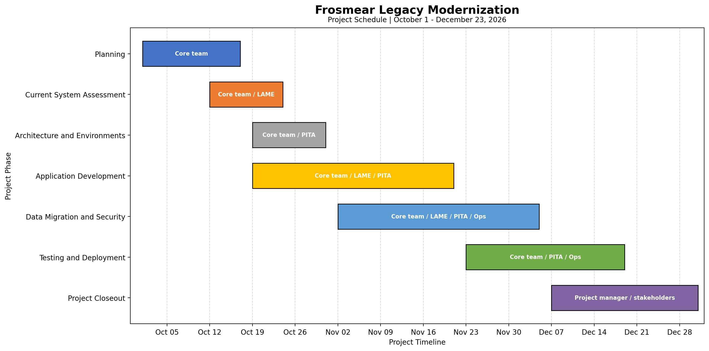

# Frosmear Legacy Modernization: Design Methodology and Integration Planning

## Introduction

The Frosmear Legacy Modernization project will replace the existing PHP-based Frosmear website with Darfcloud, a modern application platform built with Docker, Django, and MySQL. The project has a target completion date of December 30, 2026 with an estimated budget of $210,000. Its initial release will establish the platform's authentication, application navigation, legacy integration, data migration, security controls, backup procedures, and deployment.

A hybrid project management approach is appropriate because the project requires both structured planning and flexibility during development. Predictive planning will establish the scope, budget, architecture, major deliverables, and schedule. Iterative development will allow the technical team to build and validate functionality in increments. This approach provides enough structure to manage a defined modernization effort without assuming that every technical requirement or legacy dependency can be identified before development begins.

## Design Methodology and Processes

The project will begin with requirements analysis and current-system assessment. The team must identify the existing Frosmear functionality that needs to be preserved, the data that must be migrated, and the dependencies between the legacy PHP application and Darfcloud. User representatives will help identify important workflows and usability requirements. The Legacy Application Maintenance Engineering (LAME) team, led by Jay Caufield, will examine the existing application, identify compatibility concerns, and document dependencies that could affect the migration. These findings will establish the requirements and acceptance criteria for the initial release.

Architecture and environment design will follow the assessment. The technical team will define how Docker containers, Django, and MySQL will work together. This includes application structure, database organization, environment configuration, authentication interfaces, and deployment requirements. The architecture must support maintainability and provide a foundation for future applications without allowing features planned for FY2027 to expand the initial release. Zelda Hudson, CTO, will provide technical direction, while Jim Paek will lead Django and Darfcloud implementation.

Security must be considered during design rather than postponed until final testing. The Protection, Integrity, Threat Assessments (PITA) team, led by Grant Jennings, will review authentication, authorization, data integrity, and the risks associated with the legacy authentication handoff. The team will define controls and test requirements that can be incorporated into development. This includes verifying that only permitted accounts and applications receive access, protecting authentication tokens, and preventing unauthorized use of migrated account information. Early security reviews reduce the risk of discovering fundamental design problems near deployment.

Application development will use an iterative process. The development team will implement core functionality in manageable increments, review completed work, and test interactions between components. Authentication, user permissions, application navigation, and legacy integration are related capabilities, but they can be developed and evaluated in stages. Demonstrations and feedback from stakeholders will help identify missing requirements and usability problems. Defects and requested changes will be documented and evaluated against the approved project scope.

Data migration will proceed alongside application development when prerequisites permit. The team will identify the account information that must be transferred, establish mapping and validation procedures, and test the results before production use. LAME will help verify compatibility with legacy data and functionality. PITA will review access controls and data-integrity requirements. Backup and recovery procedures must be established so that migration or deployment problems do not leave the organization without a recovery path.

Integration testing will verify that the application, database, authentication processes, and relevant legacy functionality work together as intended. Functional testing will evaluate the agreed user workflows. Security testing will examine authorization, token handling, and protection of account information. Operations will review deployment procedures, backups, recovery steps, and service continuity. Issues identified during testing must be resolved or formally accepted before production release. The project will conclude with deployment, stakeholder acceptance, documentation, operational handoff, and lessons learned.

## Schedule, Coordination, and Change Control

The Gantt chart belowr presents the project schedule and the overlapping activities required to meet the December 23 target. Planning, current-system assessment, and architecture work begin early. Application development overlaps with architecture and continues while data migration and security activities proceed. Testing and deployment follow as the major components become ready. Project closeout includes acceptance, documentation, and operational transition.

**Figure 1. Frosmear Legacy Modernization Project Schedule**

The schedule deliberately allows parallel work, but overlapping activities do not eliminate dependencies. For example, migration validation depends on an adequate understanding of the legacy data, and production deployment depends on successful integration and security testing. The project manager must monitor these relationships, coordinate work between the core development team, LAME, PITA, and operations, and escalate blockers before they affect the delivery target. The schedule includes additional time for delays and closeout beyond the December 23 target; this is schedule slack, not an extension of the intended delivery commitment.

Change control will protect the project from uncontrolled scope growth. Stakeholders may identify additional features or request changes during demonstrations and reviews, but requests must be evaluated for their effects on scope, schedule, budget, resources, and risk. The project manager will coordinate with the appropriate technical and business stakeholders before recommending approval. Features that are not necessary for the initial release will remain candidates for future development unless an approved change justifies their inclusion.

## Conclusion

A hybrid methodology provides a practical structure for modernizing Frosmear while accommodating the uncertainty of legacy integration. Predictive planning establishes the project's boundaries and major commitments, while iterative development allows the team to refine functionality through implementation, review, and testing. Dedicated LAME and PITA responsibilities keep legacy compatibility and security visible throughout the project. The Gantt chart translates this approach into a coordinated schedule, showing how parallel workstreams contribute to integration, testing, deployment, and acceptance. Together, the methodology and schedule support delivery of a maintainable Darfcloud foundation by the December 23, 2026 target.

