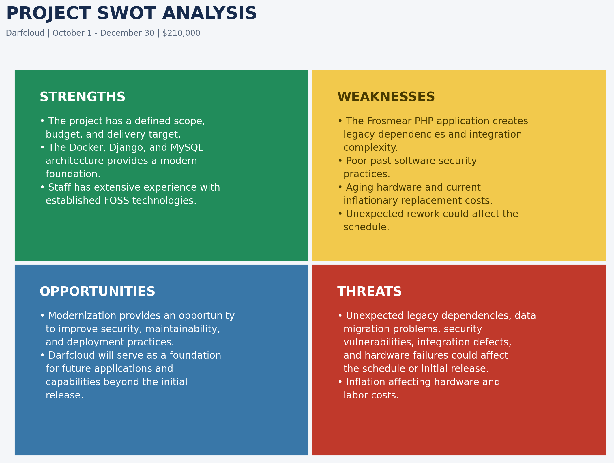
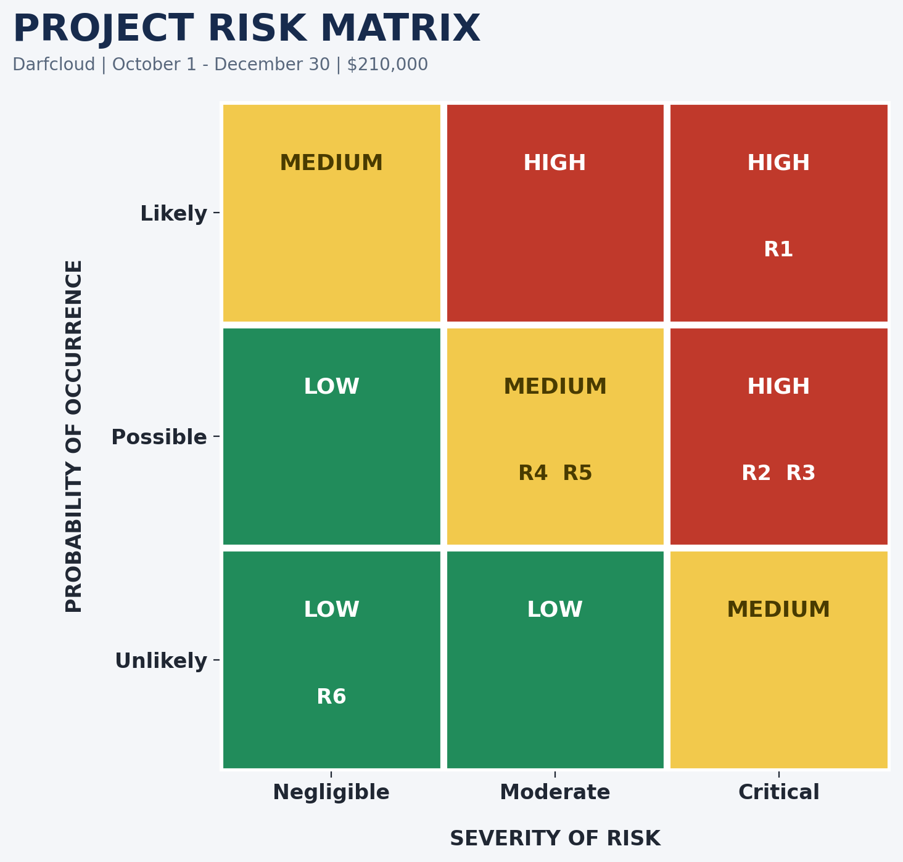
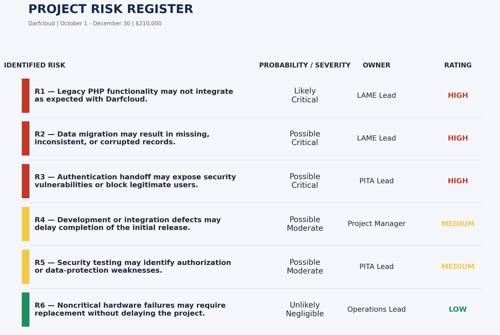

# Frosmear Legacy Modernization: Project Risk Matrix

## Introduction

The Frosmear Legacy Modernization project will replace the existing PHP-based Frosmear website with [Darfcloud](https://www.darfcloud.com), a modern application platform built with Docker, Django, and MySQL. The project has a target delivery date of December 30, 2026, with an estimated budget of $210,000. Because the project involves legacy integration, data migration, authentication changes, and deployment of a new platform, several risks could affect its schedule, budget, security, and overall success.

Risk management involves identifying potential problems, evaluating their likelihood and impact, and establishing appropriate responses. A structured approach to risk management helps project teams anticipate uncertainty and reduce its potential effects on project objectives (Association for Project Management, 2020). The resulting risks can be evaluated using a probability and severity matrix. Assigning risk owners and monitoring assumptions helps ensure that identified risks receive attention throughout the project.

## SWOT Analysis

The following SWOT analysis identifies factors that could influence the project's success.

The SWOT analysis should be reviewed with stakeholders through document reviews, brainstorming, interviews, and assumptions analysis. Its findings will be compared against the work breakdown structure to identify missing activities, validate assumptions, and determine whether additional planning is necessary.

## Risk Matrix

The project uses a 3×3 risk matrix to evaluate probability and severity. Probability is classified as likely, possible, or unlikely. Severity is classified as negligible, moderate, or critical. Combining these classifications produces a low, medium, or high risk rating.

## Project Risk Register

The following register identifies six major risks associated with the modernization project.

## Risk Synopsis

**R1 – Legacy application compatibility**

Differences between the legacy PHP application and the new Django/MySQL platform may prevent selected functionality from integrating as expected. The legacy code includes untracked PHP files that call several Python 2 helper scripts. This will likely require redesign, additional testing, or postponement of features.

**R2 – Data migration problems**

Differences in database structures and legacy data quality may result in missing, inconsistent, or corrupted records. This could require repeated migrations, data correction, and backup restoration, delaying acceptance.

**R3 – Authentication and security handoff**

Coordination between legacy and Darfcloud authentication may expose security vulnerabilities or block legitimate users. This could require access-control corrections and additional testing before release.

**R4 – Development and integration delays**

Development defects or integration problems may delay dependent activities, compress testing time, or increase labor costs. This may require postponing nonessential functionality to protect the initial release schedule.

**R5 – Security weaknesses discovered during testing**

Security testing may identify authorization or data-protection weaknesses requiring rework. This could increase costs or delay deployment, particularly if significant findings require corrections and retesting.

**R6 – Noncritical hardware failures**

Noncritical hardware failures may require replacement. This has negligible impact because hardware replacement can be handled through existing operational resources without affecting major project milestones.

## Risk Ownership and Response Planning

Each identified risk has an owner responsible for monitoring its status and coordinating the appropriate response. Assigning ownership makes risk management an active responsibility shared across the project teams.

| ID | Risk | Owner | Response |
|---|---|---|---|
| R1 | Legacy application compatibility | LAME Lead | Monitor legacy dependencies and integration results. Test compatibility incrementally and defer features that cannot be integrated on schedule. |
| R2 | Data migration problems | LAME Lead | Monitor migration accuracy, completeness, and validation results. Use test migrations, validate source data, preserve backups, and establish recovery procedures. |
| R3 | Authentication and security handoff | PITA Lead | Monitor authentication, authorization, and token security. Review the handoff throughout development and resolve critical vulnerabilities. |
| R4 | Development and integration delays | Project Manager | Monitor milestones, dependencies, and schedule variance. Track progress, address delays, and defer nonessential features. |
| R5 | Security weaknesses discovered during testing | PITA Lead | Monitor security testing and remediation. Assign corrective work and repeat testing to verify that significant weaknesses are resolved. |
| R6 | Noncritical hardware failures | Operations Lead | Monitor critical equipment and replacement needs. Maintain hardware inventory and arrange replacements. |

The project manager will coordinate regular risk reviews, update the risk register, and ensure responses are implemented when necessary. Risks that materialize will be tracked as issues and managed through established change-control and communication processes. Consistent identification, analysis, response planning, and monitoring help project teams address uncertainty before it threatens delivery (Association for Project Management, 2020; Thomas, n.d.). Effective mitigation also requires considering the organizational and project context when selecting responses (Maruping et al., 2019).

## Conclusion

The Frosmear Legacy Modernization project involves technical and organizational risks that could affect its schedule, budget, security, and delivery. The SWOT analysis identifies internal capabilities and external conditions, while the 3×3 risk matrix provides a consistent method for evaluating and prioritizing potential problems. The risk register establishes specific responses and assigns responsibility for monitoring each risk. Regular reviews, assumption tracking, and communication with stakeholders will help the project respond to changing conditions and protect its December 2026 delivery target.

## References

Association for Project Management. (2020). [*What is risk management?*](https://www.apm.org.uk/resources/what-is-project-management/what-is-risk-management/)

Maruping, L. M., Venkatesh, V., Thong, J. Y. L., & Zhang, X. (2019). [A risk mitigation framework for information technology projects: A cultural contingency perspective](https://csuglobal.idm.oclc.org/login?url=https%3A%2F%2Fsearch.ebscohost.com%2Flogin.aspx%3Fdirect%3Dtrue%26db%3Dcph%26AN%3D135672066%26site%3Deds-live). *Journal of Management Information Systems, 36*(1), 120–157.

Thomas, C. (n.d.). [*Five steps of the risk management process in 2025*](https://www.360factors.com/blog/five-steps-of-risk-management-process/). 360Factors.
